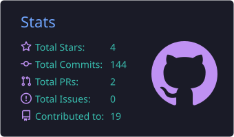
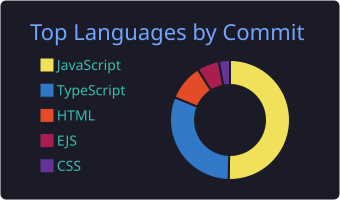
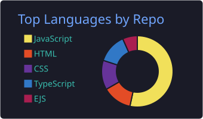
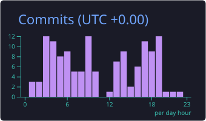

<h1 align="left">
  
  
</h1>

## About Me:

**ECE Student | Building ideas into code | Exploring AI, Web Development & Problem Solving**

Electronics Engineering Student passionate about software development, AI, and web technologies. I enjoy transforming ideas into practical applications, continuously learning new technologies, and collaborating to solve real-world problems through innovation and code.

## 🌐 Socials:

## 💻 Tech Stack:

## 📊 GitHub Stats:

  
  

  
  

  

## 🐍 Contribution Snake

<picture>
  <source media="(prefers-color-scheme: dark)" srcset="https://raw.githubusercontent.com/creativeprem789/creativeprem789/output/github-snake-dark.svg" />
  <source media="(prefers-color-scheme: light)" srcset="https://raw.githubusercontent.com/creativeprem789/creativeprem789/output/github-snake.svg" />
  
</picture>

## ✍️ Random Dev Quote

  

